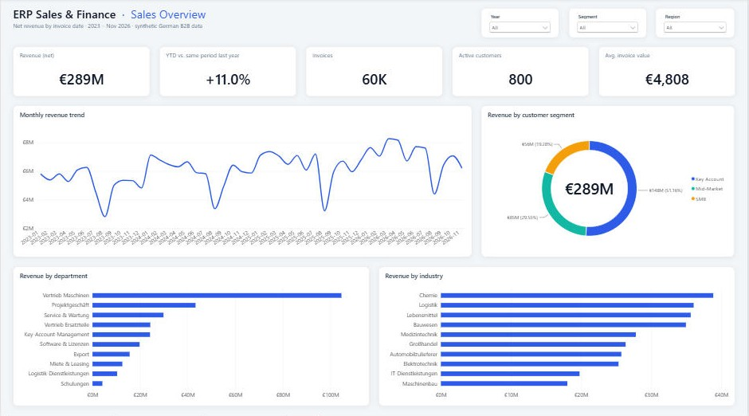
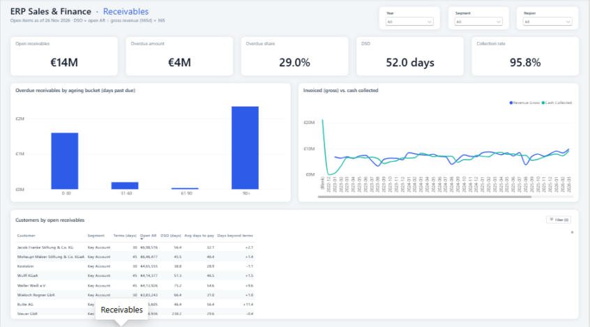
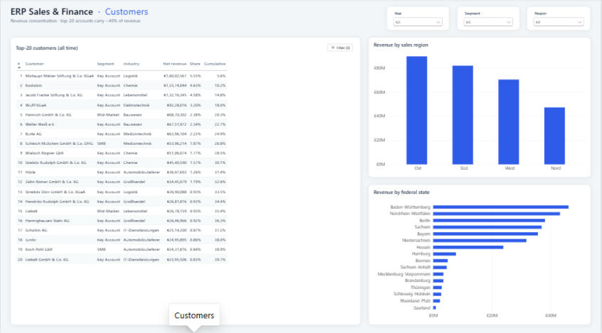

# ERP Sales & Finance Reporting – Data Layer

This project generates a synthetic German B2B ERP dataset (customers, cost centres, about 60k invoices from 2023 to Nov 2026).
It loads the data into a Postgres star schema and adds analytics views for a Power BI report.
The data is **deliberately dirty** so you can practise cleaning it.

## Dashboard

Power BI report: open [`ERP_Reporting.pbip`](ERP_Reporting.pbip) in Power BI Desktop. It is stored as a Power BI Project (PBIR + TMDL), so it can be diffed in Git.
The pages are generated by [`build_dashboard.py`](build_dashboard.py).

| Sales Overview | Receivables | Customers |
|---|---|---|
|  |  |  |

**Tech:** PostgreSQL 16 (Docker) · Python (pandas, Faker, psycopg2) · SQL (star schema, window functions) · Power BI (DAX, PBIP)

## Setup

Prerequisites: Docker Desktop and Python 3.10+.

```powershell
copy .env.example .env          # then set a password
python -m venv .venv
.\.venv\Scripts\Activate.ps1
pip install -r requirements.txt
docker compose up -d
python load.py
```

`load.py` is idempotent. Each run drops and recreates the schema and reloads everything in **one transaction**,
then prints the row counts and a data-quality snapshot. Re-run it any time.
The seed is fixed, so every run produces the same data.

To get the raw data as CSV files for Power Query practice, run `python generate_data.py`. It writes the files to `data/raw/`.

The container is published on host port **5433** (set in `.env`), so it doesn't clash with a locally installed PostgreSQL on 5432.

**Power BI:** Get Data → PostgreSQL → server `127.0.0.1:5433`, database `erp_reporting`, Import mode.
Load the four tables plus the `vw_*` views. Measures are in [MEASURES.md](MEASURES.md).

## Data model

Star schema, one row per invoice in the fact:

```
 dim_customer ──┐
                ├──< fact_invoice >──┬── dim_date (invoice date, active)
 dim_costcentre ┘                    ├── dim_date (due date, inactive)
                                     └── dim_date (payment date, inactive)
```

| Table | Rows | Key | Content |
|---|---|---|---|
| `fact_invoice` | ~60k | `invoice_key` | amounts (net/VAT/gross), invoice/due/payment dates, status, invoice number (degenerate dim) |
| `dim_customer` | 800 | `customer_key` | name, segment, industry, city/state/region, payment terms, credit limit |
| `dim_costcentre` | 40 | `costcentre_key` | 10 departments × 4 sales regions |
| `dim_date` | 2022–2027 | `date_key` (YYYYMMDD) | calendar attributes |

- Surrogate keys are identity integers. Natural keys (`customer_number`, `costcentre_code`) are kept as UNIQUE columns.
- `dim_date` is role-playing. In Power BI only the invoice-date relationship is active, and the other two are activated with `USERELATIONSHIP`.
- The "as-of date" is `MAX(invoice_date)` (2026-11-26), not `CURRENT_DATE`, so the numbers don't drift as real time passes.
- [schema.sql](schema.sql) explains for each column why it sits on the fact or on a dimension.

### Views ([analytics_views.sql](analytics_views.sql))
| View | Purpose |
|---|---|
| `vw_revenue_by_month` | net/gross revenue, YTD, prior year, YoY % |
| `vw_dso_by_customer` | balance-based DSO + amount-weighted days-to-pay vs. terms |
| `vw_overdue_ageing` | open overdue AR in 0-30 / 31-60 / 61-90 / 90+ buckets |
| `vw_top20_customers` | rank, revenue share, cumulative (Pareto) share |

## Known data-quality issues (for you to clean)
| Issue | Approx. count | Where |
|---|---|---|
| `payment_status = 'PAID'` but `payment_date` NULL | ~2% of paid invoices | `fact_invoice` |
| Duplicate invoice numbers: 15 exact duplicate rows + 10 number collisions | 25 | `fact_invoice.invoice_number` |
| Customer names with trailing whitespace | 3 | `dim_customer.customer_name` |
| `payment_date` before `invoice_date` | 120 | `fact_invoice` |

Also built in, and realistic rather than a defect: about 12% of customers are chronic late payers, about 0.8% of invoices are never paid (bad debt), revenue grows over time with seasonal patterns, and revenue is concentrated in a few customers (Pareto).
